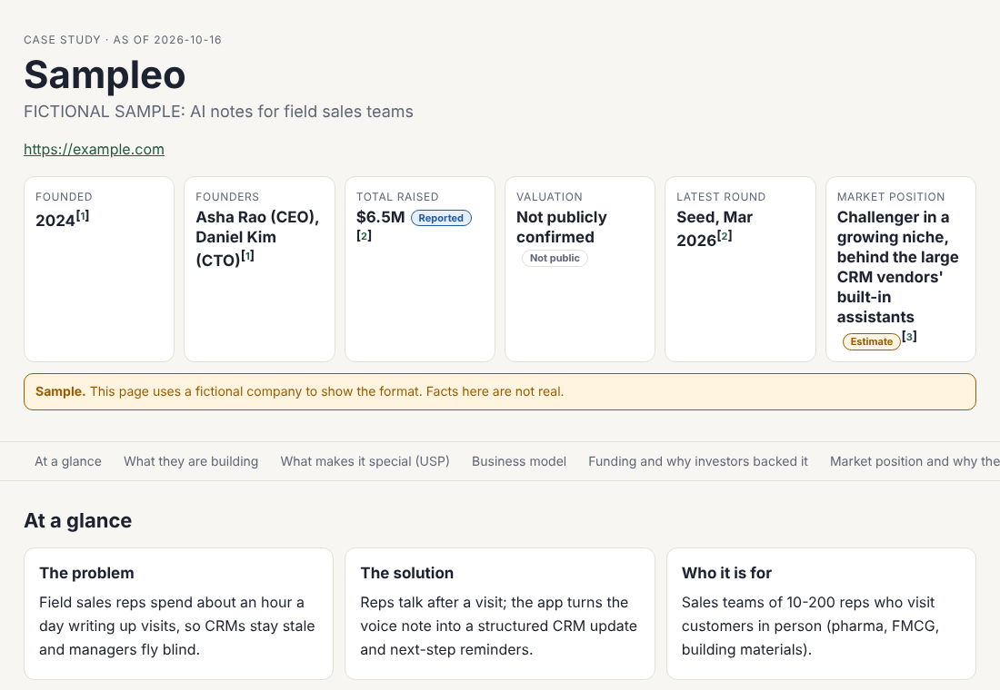
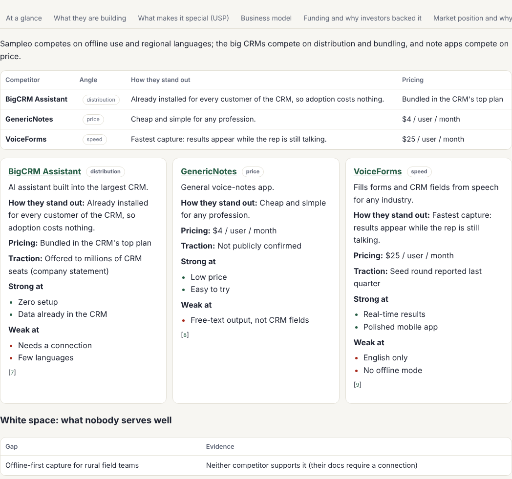
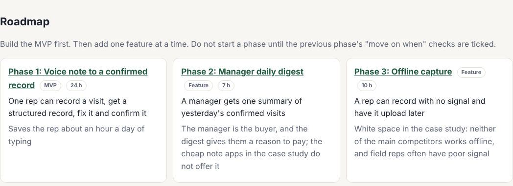
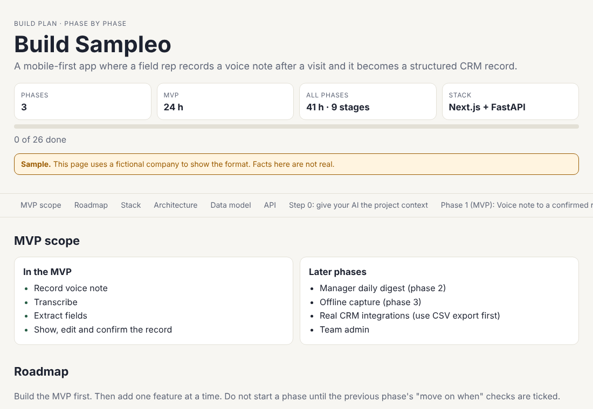

# RUB: Research, Understand, Build

**Pick a startup. Get an HTML case study. Get a learn plan and a build plan. Build your own.**

RUB is an open-source toolkit for Claude Code. It helps you study the AI startups and software products that are
winning right now, understand the business *and* the technology, and turn what you learn into your own original
product, with the marketing plan to match. It uses only public information and uses products the way a normal customer
would. It never looks inside private code. See [SAFETY.md](SAFETY.md).

| | Step | You give it | You get |
| --- | --- | --- | --- |
| **R** | **Research** | A startup or product | A sourced HTML **case study** |
| **U** | **Understand** | The same case study | How it works, who funded it and why, why it leads, its drawbacks, where you could do better |
| **B** | **Build** | "Learn plan" or "Build plan" | A week-by-week **learn plan** (to code it yourself) or a **build plan** with step-by-step **vibe-coding prompts** |



## What is in a case study

When it started and by whom, what they are building, features, what makes it special (USP), business model and pricing,
funding rounds, investors, total raised and valuation, market position, why they lead, **the competitors that are doing well and how
each one differentiates** (price, niche, speed, integrations, region, distribution, brand) plus the **white space** nobody serves well,
how they got customers, their technology (what is public vs what is typical), strengths, **drawbacks**, a timeline, and opportunities
for a smaller newcomer.

Every fact carries a label: **Confirmed** (the company or a primary document says it), **Reported** (a credible outlet says it),
**Estimate** (our calculation, with its inputs cited) or **Not publicly confirmed**. Facts you cannot find are shown as unknown,
never guessed. Every source is numbered and linked at the bottom of the page.



See a complete example (a fictional company, clearly marked as a sample):
[case study](examples/sample-startup/CASESTUDY.html) ·
[learn plan](examples/sample-startup/LEARN-PLAN.html) ·
[build plan](examples/sample-startup/BUILD-PLAN.html) ·
[prompts](examples/sample-startup/prompts/PROMPTS.md)

## Install

In Claude Code:

```
/plugin marketplace add chadaramkarunakar16/rub
/plugin install rub@rub
```

(From a local copy: `/plugin marketplace add /path/to/rub`.) Then run `/rub:doctor` to check your setup. You need Python 3.9+
(`python` on Windows). The scripts use only the standard library.

## Quick start

```
/rub:research Lovable                       # 1. HTML case study in studies/lovable/CASESTUDY.html
/rub:learn lovable beginner 10              # 2a. what to learn, week by week, if you build it by hand
/rub:plan lovable Next.js + Supabase        # 2b. phased build plan: MVP first, then one feature per phase, with prompts
/rub:build lovable                          # 3. builder writes the next stage (1.1, 1.2 ... then phase 2, 3 ...)
/rub:launch my-app like Lovable, $19/mo     # 4. go-to-market plan to your MRR target
```

The build plan is for an **original** product for a narrow audience, not a clone. It tells you what to keep, what to drop, and
what to do better. It is **phased**: Phase 1 is the smallest MVP, and every later phase adds exactly one feature, each with a reason
(why it is next), its own stages and prompts, and "move on when" checks to do with real users before you continue.





## All commands

**The main path**

| Command | What you get |
| --- | --- |
| `/rub:research <startup>` | HTML case study with sources and confidence labels, including competitors and how they differentiate |
| `/rub:learn <slug> [level] [hours/week]` | `LEARN-PLAN.html`: topics, why you need each, exercises, free resources, milestones |
| `/rub:plan <slug> [stack]` | `BUILD-PLAN.html` and `prompts/`: stack, architecture, data model, API, then a roadmap of phases (MVP, then one feature each) with phase briefs, stage prompts and "done when" / "move on when" checks |
| `/rub:build <slug> [phase.stage]` | The builder writes your original code one stage at a time, MVP first, then one feature per phase, and tracks progress in `PROGRESS.md` |
| `/rub:launch <product> like <competitor>` | Go-to-market plan: how the competitor won, what works now, phases to your MRR target, user math, 4-week schedule, tickable roadmap, with ethics rules built in |

**Market research**

| Command | What you get |
| --- | --- |
| `/rub:scan YC S26 AI` | A dataset of a YC batch, recent funding or a category: problem, customer, model, funding, investors |
| `/rub:startup <name>` | A one-screen profile and a lesson for you |
| `/rub:patterns <focus>` | Connects the dots across all your research: where the money goes, crowded vs open spaces, ranked ideas |
| `/rub:top <category>` | The leading paid tools in a category, compared |
| `/rub:compare A vs B` | Side by side, and where a newcomer could win |
| `/rub:track <name>` | Dated snapshots of public pricing, changelog and careers pages, and what changed |

**Understand more deeply**

| Command | What you get |
| --- | --- |
| `/rub:observe <product>` | Uses the product like a customer in a browser and records screenshots and insights (never code) |
| `/rub:explain <feature>` | A lesson on how a type of feature works, why, and what to learn |
| `/rub:investigate <feature>` | Research, design, stack and learning plan for one feature, then an MVP if you approve |
| `/rub:opensource <repo URL>` | Tour of a public open-source repo: licence, stack, data model, one feature end to end |
| `/rub:check <slug>` | Checks your build against its plan: covered, partial, missing |
| `/rub:content <study> [format]` | Carousels, reel scripts, posts and threads from verified facts only |

**Housekeeping:** `/rub:dashboard` (one page of everything you have studied) and `/rub:doctor` (install check).

## How it works

- **Skill** (`skills/method`): the method, evidence rules and reference guides (patterns, learning, business, startups, channels).
- **Agents** (`agents/`): `strategist`, `competitor-analyst`, `market-scout`, `scout`, `architect`, `stack-advisor`, `observer`, `verifier`,
  `case-writer`, `plan-writer`, `builder`, `growth-strategist`, `cartographer`, `opportunity-mapper`.
- **Workflows** (`skills/<command>/`): chain the agents, with a separate **verifier** that re-checks claims against their sources.
- **Tools** (`scripts/`): `rubdoc.py` (case study, learn plan, build plan, prompts), `ledger.py` (evidence ledger), `dataset.py`,
  `snapshot.py`, `walkthrough.py`, `gtm.py`, `repomap.py`, `dashboard.py`, `doctor.py`. Tests in `tests/`.

## Where your research is saved

```
studies/<slug>/   case.json, CASESTUDY.html, competitors.md, learn.json, LEARN-PLAN.html, build.json, BUILD-PLAN.html,
                  prompts/, business.md, features/, walkthrough/, snapshots/, ledger.json, EVIDENCE.md, gtm/
```

`studies/` is git-ignored so your research stays yours.

## Honest by design

- Facts have confidence labels, numbered sources, and an independent verifier pass; unknowns stay unknown.
- A case study must include drawbacks.
- Technology is only called "confirmed" when the company itself published it (docs, engineering blog, job posts, public repos).
  Otherwise it is labelled "typical".
- Plans always aim at an original product. Do not copy a company's code, design, text or brand.
- AI can make mistakes. Check anything important at its source before you rely on it, especially funding and valuation.

## Develop

```
pip install pytest
python -m pytest tests -q
python scripts/doctor.py
python scripts/rubdoc.py template case     # see the case study schema
```

See [CONTRIBUTING.md](CONTRIBUTING.md). MIT licensed.
