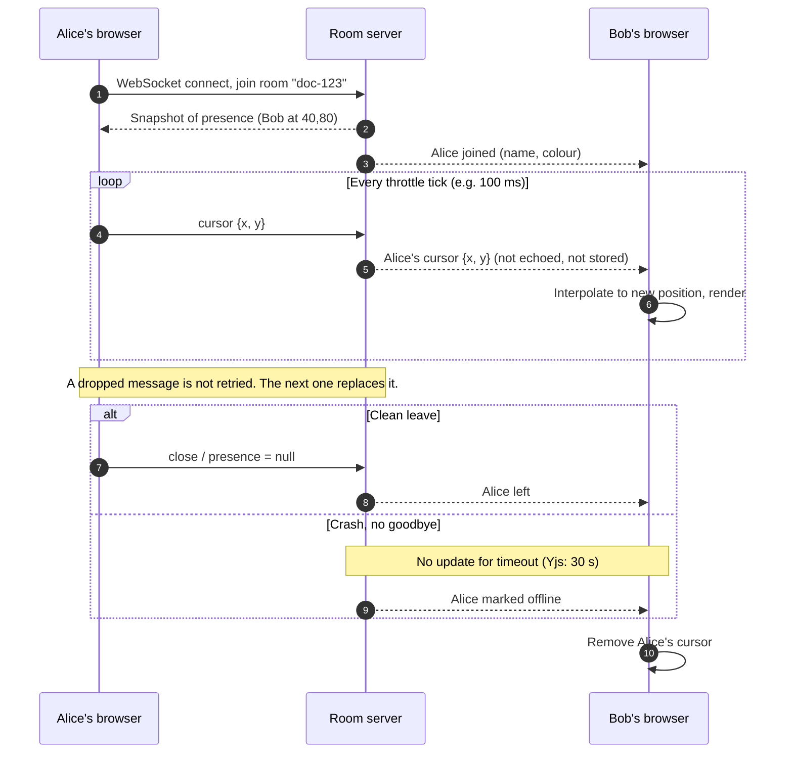

# Lesson: Live cursors like Figma

> **Evidence note.** The research agent could not open any primary page in full (the proxy blocked them), so every "Confirmed" label rests on search-result summaries. Re-open the linked sources before relying on a detail. Nothing public the scout reached describes how Figma itself sends cursors, so the flow below is the **generic pattern**. Labels: **Confirmed** (a source says it), **Common pattern** (standard approach), **Unverified** (no source found).

## The feature in one line

While several people have the same document open, each sees the others' pointers (with name and colour) moving in near real time, and a cursor disappears when its owner leaves.

## How it works

1. **Join a room.** Your browser opens a long-lived WebSocket and joins the room for that document. Figma clients talk to a server cluster over WebSockets, and each document gets its own server process that everyone editing it connects to (Confirmed; the post says "currently", so it may be dated). Figma's later Rust post says each document lives on one worker (Confirmed via search summary).
2. **Announce presence.** Your client publishes a small record such as `{ userId, name, colour, x, y }` and receives a snapshot of who is already there (Supabase `track()` / `presenceState()`, Liveblocks `updatePresence()` / `useOthers()`: Confirmed via search summaries).
3. **Throttle.** Mouse events fire 60+ times a second. The client sends only the latest position every N ms. Liveblocks defaults to 100 ms and can go to 16 ms (Confirmed via search summary).
4. **Fan out.** The room server relays each update to everyone else in the room, not back to the sender (Common pattern).
5. **Don't store it.** Cursor data is ephemeral. Supabase Broadcast doesn't persist messages (Confirmed). Whether Figma stores cursors is Unverified.
6. **Smooth on arrival.** Updates arrive unevenly, so the receiver animates between positions with a CSS transition, spring or spline (Confirmed, Liveblocks blog).
7. **Tolerate loss.** A dropped update is never retried, because the next one replaces it. Supabase's README warns delivery isn't guaranteed (Confirmed via search summary).
8. **Leave or time out.** A clean disconnect removes the cursor. A crashed client is caught by a timeout; Yjs awareness marks a peer offline after 30 s without an update (Confirmed via search summary).
9. **Reconnect.** Re-announce yourself and take a fresh snapshot. Don't replay missed moves (Common pattern).

## Why it is built that way

**The problem is latency versus bandwidth at fan-out scale.** Each person generates 60+ events a second, and every update must reach everyone else, so a room of N people produces roughly N × (N−1) messages per tick (Common pattern). The network also delivers late, unevenly and sometimes not at all. The usual answer: throttle on the sender, interpolate on the receiver, and treat cursors as ephemeral, latest-wins data kept separate from the durable document.

| Approach | Good at | Bad at | Use when |
|---|---|---|---|
| **Managed presence service** (Liveblocks, Supabase Realtime, hosted PartyKit) | Fastest to ship; rooms, cleanup and throttling built in | Lock-in, per-connection/message pricing, less control. Internal limits not read (Unverified) | Small team; cursors are a feature, not the product |
| **Self-hosted room server** (custom WebSocket protocol; Figma's per-document process is the confirmed example) | Full control; fan-out in one process; can tie to the document model | You own sticky routing, deploys that drop sockets, reconnect and scaling | Collaboration is the core product |
| **CRDT awareness** (Yjs awareness over y-websocket, WebRTC) | Open source, transport-agnostic, built-in clock and 30 s timeout | Full-state messages get chatty at scale; you still run the transport | You already use Yjs for the document |

Scaling choice (Common pattern): pin each room to one owner process, or run stateless gateways behind a pub/sub backplane such as Redis. That Figma's single-owner design means in-process cursor fan-out is an **inference**, not something Figma states.

## Key concepts

| Concept | Definition | Analogy |
|---|---|---|
| WebSocket | A connection that stays open so both sides can send at any time | A phone call that stays connected, not a letter per sentence |
| Room / channel | The group of connections that receive each other's updates | A meeting room: only people inside hear you |
| Presence | Small live "who's here and doing what" state tied to a connection | Conference name badges, thrown away when you leave |
| Ephemeral vs durable state | Ephemeral is discarded; durable is saved and must not be lost | Pointing at a whiteboard vs writing on it |
| Throttling | Send at most one update per interval, always the latest | A news ticker refreshing every few seconds |
| Interpolation | Receiver animates between last and new position | A flipbook with the in-between frames drawn |
| Fan-out | One incoming message copied to every other member | One group-chat message reaching everyone's phone |
| Latest-wins / loss tolerance | Only the newest value matters; no retries | A scoreboard: just read the current score |
| Heartbeat / timeout | Clients re-send periodically; silent ones are treated as gone | A lifeguard's head count |
| Sticky routing | Everyone in a room reaches the same server process | A study group at one table |
| Pub/sub backplane | A shared bus that lets many servers forward room messages | An intercom linking several meeting rooms |

## What to learn to build it

Ordered, with one free resource each (from `references/learning.md`; verify links still work):

1. **HTTP and APIs**: MDN Web Docs, "An overview of HTTP".
2. **JavaScript / TypeScript**: javascript.info.
3. **React + Next.js** (for rendering cursors): react.dev "Learn".
4. **WebSockets and realtime** (the core skill): MDN "WebSockets API" and the Supabase Realtime docs.
5. **Caching and Redis** (pub/sub when you outgrow one server): Redis University free courses.
6. **CRDTs and collaboration** (only if you add shared document editing): Yjs docs and Martin Kleppmann's "CRDTs: The Hard Parts" talk.
7. **System design basics**: the "System Design Primer" on GitHub.
8. **Deployment**: Vercel docs or Docker "Get started".

## Check your understanding

1. Why not send an update on every `pointermove`, and what stops the cursor looking choppy once you throttle?
2. A cursor message is dropped. Should the system retry it or save it to the database? Why?
3. Bob's laptop dies without closing the connection. How does Alice's screen eventually drop his cursor, and what do we know or not know about Figma here?

Answers

1. Pointer events fire 60+ times a second and each update is fanned out to everyone else, so cost grows roughly with N × (N−1). Throttle on the sender (Liveblocks defaults to 100 ms). The receiver then interpolates with a CSS transition, spring or spline, so motion looks smooth despite sparse, uneven updates.
2. Neither. Cursor position is ephemeral and latest-wins: the next update makes the lost one irrelevant, and a retry could even show an old position after a newer one. Storing it adds write load for data nobody needs later. Durable document edits are handled separately.
3. With no goodbye message, the system relies on a timeout. Clients re-broadcast as a heartbeat, and a peer silent for too long is marked offline (Yjs awareness: 30 s). Servers also clean up presence when a socket drops, as Supabase Presence does. For Figma we know (Confirmed) that everyone on a document connects to one per-document process over WebSockets. Its cursor timeout, idle behaviour and whether cursors share the document channel are Unverified, so any specific Figma number would be a guess.

## Sources

Re-open these before relying on any detail; the research used search summaries, not full-page reads.

- Figma, how multiplayer works: https://www.figma.com/blog/how-figmas-multiplayer-technology-works/ (mirror: https://madebyevan.com/figma/how-figmas-multiplayer-technology-works/)
- Figma, Rust in production: https://medium.com/figma-design/rust-in-production-at-figma-e10a0ec31929
- Liveblocks, animating multiplayer cursors: https://liveblocks.io/blog/how-to-animate-multiplayer-cursors
- Liveblocks, live cursors tutorial: https://liveblocks.io/docs/tutorial/react/getting-started/live-cursors
- Supabase Realtime: https://supabase.com/realtime.md , https://supabase.com/docs/guides/realtime.md , https://github.com/supabase/realtime/blob/main/README.md
- Yjs awareness: https://docs.yjs.dev/api/about-awareness , https://github.com/yjs/y-protocols/blob/master/PROTOCOL.md
- PartyKit: https://docs.partykit.io/tutorials/2-adding-realtime-cursors , https://blog.partykit.io/posts/dancing-cursors-and-voronoi-diagrams
- (secondary) https://www.techinterview.org/post/3233475141/build-real-time-collaborative-cursors/
- Working files: `scout.md` and `explanation.md` in this folder.
